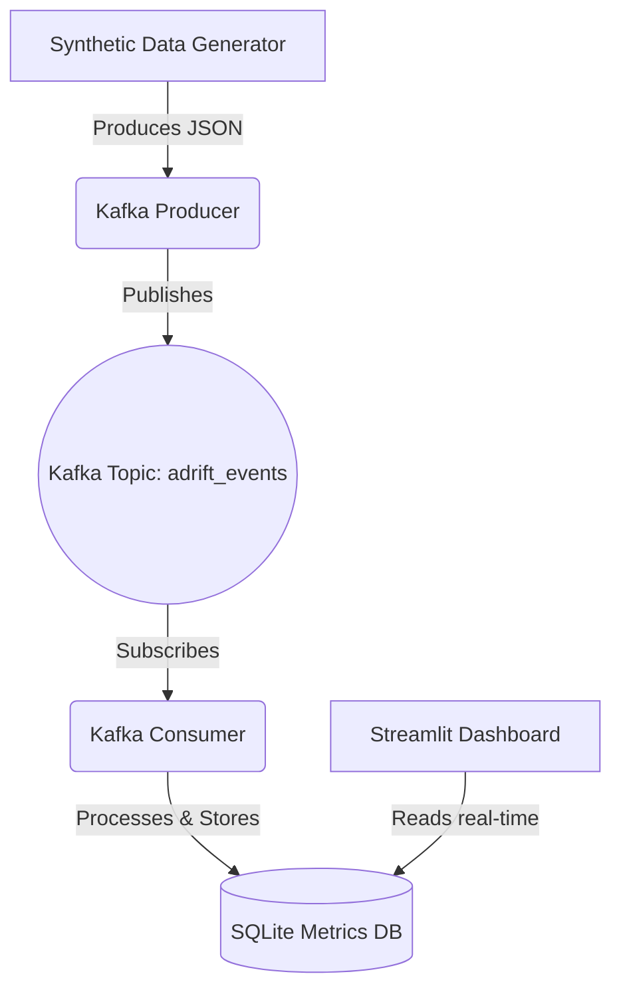

# ADRIFT: Adaptive Drift-Aware Recovery Framework for Intelligent Streaming Pipelines
*(Phase 1)*

## Project Overview
ADRIFT is a research project focused on building an intelligent streaming data pipeline capable of handling concept drift and automating recovery using reinforcement learning.

This repository contains **Phase 1** of the project, which establishes the core real-time streaming data pipeline foundation. It includes a Kafka-based ingestion system, a data consumer that persists events, and a Streamlit dashboard for real-time monitoring and visualization.

## Architecture Diagram


## Folder Structure
```text
ADRIFT/
│
├── config/              # Centralized configuration and logging setup
├── consumer/            # Kafka consumer service script
├── dashboard/           # Streamlit dashboard application
├── data/                # Local SQLite DB and sample dataset storage
├── docker/              # Additional Docker scripts (if any)
├── docs/                # Project documentation
├── logs/                # Application log outputs
├── monitoring/          # Metrics tracking service module
├── producer/            # Kafka producer service script
├── tests/               # Unit tests
│
├── .env                 # Environment variables configuration
├── docker-compose.yml   # Docker compose for Kafka and Zookeeper
├── requirements.txt     # Python dependencies
└── README.md            # This documentation file
```

## Installation Steps
1. **Clone the repository** (or navigate to the folder if generated locally).
   ```bash
   cd ADRIFT
   ```

2. **Create a Python virtual environment** (recommended):
   ```bash
   python3 -m venv venv
   source venv/bin/activate
   ```

3. **Install dependencies**:
   ```bash
   pip install -r requirements.txt
   ```

## Docker Setup (Kafka & Zookeeper)
You must have Docker and Docker Compose installed.

1. Start the Kafka infrastructure in the background:
   ```bash
   docker-compose up -d
   ```
2. Wait a few seconds for Zookeeper and Kafka to initialize. You can check the status using:
   ```bash
   docker-compose ps
   ```

## Running the Pipeline

You need to run the Producer, Consumer, and Dashboard in separate terminal windows. Make sure your virtual environment is activated in each window.

### 1. Running the Producer
The Producer generates synthetic streaming data and pushes it to Kafka.
```bash
python producer/producer.py
```

### 2. Running the Consumer
The Consumer reads from Kafka, computes pipeline metrics, and logs data to the SQLite database.
```bash
python consumer/consumer.py
```

### 3. Running the Dashboard
The Streamlit Dashboard reads the SQLite database and presents real-time charts.
```bash
streamlit run dashboard/app.py
```
*The dashboard will automatically open in your default web browser (usually http://localhost:8501).*

## Troubleshooting Guide
- **`NoBrokersAvailable` error in Producer/Consumer:**
  This means Kafka is not ready yet or the container failed to start. Run `docker-compose ps` to ensure the `kafka` container is `Up`. If it's not, try restarting with `docker-compose restart kafka`.
- **Dashboard not updating:**
  Ensure both the `producer.py` and `consumer.py` scripts are actively running without errors. Check the `logs/producer.log` and `logs/consumer.log` files for any tracebacks.
- **`ModuleNotFoundError: No module named ...`:**
  Make sure you have activated your virtual environment and run `pip install -r requirements.txt` from the project root.
- **Port Conflicts:**
  If ports `9092` (Kafka), `2181` (Zookeeper), or `8501` (Streamlit) are in use, you can update them in the `docker-compose.yml` and `.env` files respectively.
